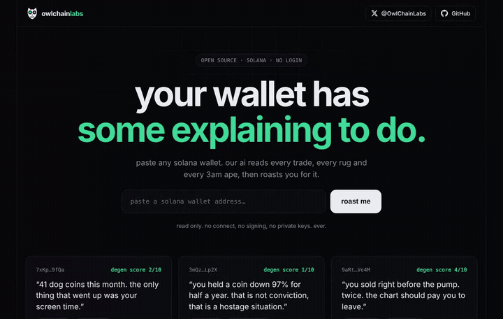
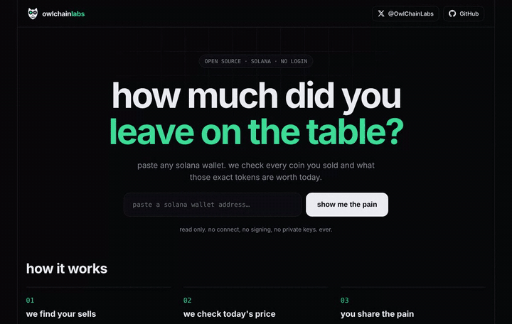

# 🦉 owl chain labs

open source tools for solana traders. 
built at night by a solo dev. no private keys. ever.

---

wallet-roast in action (sample wallet)

  

paper hands calculator in action (sample wallet)

---

### 🛠 tools

| tool | what it does | status |
|:--|:--|:--|
| 🔥 **[wallet-roast](https://github.com/OwlChainLabs/wallet-roast)** | paste a solana wallet, get roasted by ai |  |
| ⚔️ **[terminal-wars](https://github.com/OwlChainLabs/terminal-wars)** | which solana trading terminal makes the most money |  |
| 🧻 **[paper-hands](https://github.com/OwlChainLabs/paper-hands)** | what the coins you sold would be worth today |  |
| 🎁 **solana wrapped** | your trading year as shareable story cards |  |

---

### 🔒 principles

- 100% open source, read every line
- we only use public wallet addresses
- we will never ask for your private key or seed phrase

---

new tool every few weeks. follow on [x](https://x.com/OwlChainLabs) to catch the next drop.

